# Diagramme de cas d'utilisation

Ce diagramme resume les actions disponibles selon les roles `MAGASINIER`, `MANAGER` et `ADMIN`.

```mermaid
flowchart LR
    MAGASINIER[Magasinier]
    MANAGER[Manager]
    ADMIN[Administrateur]

    subgraph SYSTEM[StockManager]
        LOGIN((Se connecter))
        LIST_PRODUCTS((Lister les produits))
        VIEW_PRODUCT((Consulter un produit))
        UPDATE_PRODUCT((Modifier un produit))
        CREATE_PRODUCT((Ajouter un produit))
        DELETE_PRODUCT((Supprimer un produit))
        LIST_CATEGORIES((Lister les categories))
        UPDATE_CATEGORY((Modifier une categorie))
        CREATE_CATEGORY((Ajouter une categorie))
        DELETE_CATEGORY((Supprimer une categorie))
        LIST_MOVEMENTS((Consulter les mouvements))
        CREATE_MOVEMENT((Enregistrer IN/OUT))
        VIEW_ALERTS((Voir les alertes))
        MANAGE_USERS((Gerer les utilisateurs))
    end

    MAGASINIER --> LOGIN
    MAGASINIER --> LIST_PRODUCTS
    MAGASINIER --> VIEW_PRODUCT
    MAGASINIER --> LIST_CATEGORIES
    MAGASINIER --> LIST_MOVEMENTS
    MAGASINIER --> CREATE_MOVEMENT
    MAGASINIER --> VIEW_ALERTS

    MANAGER --> LOGIN
    MANAGER --> LIST_PRODUCTS
    MANAGER --> VIEW_PRODUCT
    MANAGER --> UPDATE_PRODUCT
    MANAGER --> LIST_CATEGORIES
    MANAGER --> UPDATE_CATEGORY
    MANAGER --> LIST_MOVEMENTS
    MANAGER --> CREATE_MOVEMENT
    MANAGER --> VIEW_ALERTS

    ADMIN --> LOGIN
    ADMIN --> LIST_PRODUCTS
    ADMIN --> VIEW_PRODUCT
    ADMIN --> CREATE_PRODUCT
    ADMIN --> UPDATE_PRODUCT
    ADMIN --> DELETE_PRODUCT
    ADMIN --> LIST_CATEGORIES
    ADMIN --> CREATE_CATEGORY
    ADMIN --> UPDATE_CATEGORY
    ADMIN --> DELETE_CATEGORY
    ADMIN --> LIST_MOVEMENTS
    ADMIN --> CREATE_MOVEMENT
    ADMIN --> VIEW_ALERTS
    ADMIN --> MANAGE_USERS
```

## Matrice des droits

| Fonction | MAGASINIER | MANAGER | ADMIN |
| --- | --- | --- | --- |
| Consulter produits, categories, mouvements, alertes | Oui | Oui | Oui |
| Modifier produits et categories | Non | Oui | Oui |
| Ajouter/supprimer produits et categories | Non | Non | Oui |
| Enregistrer une entree/sortie de stock | Oui | Oui | Oui |
| Gerer les utilisateurs | Non | Non | Oui |
