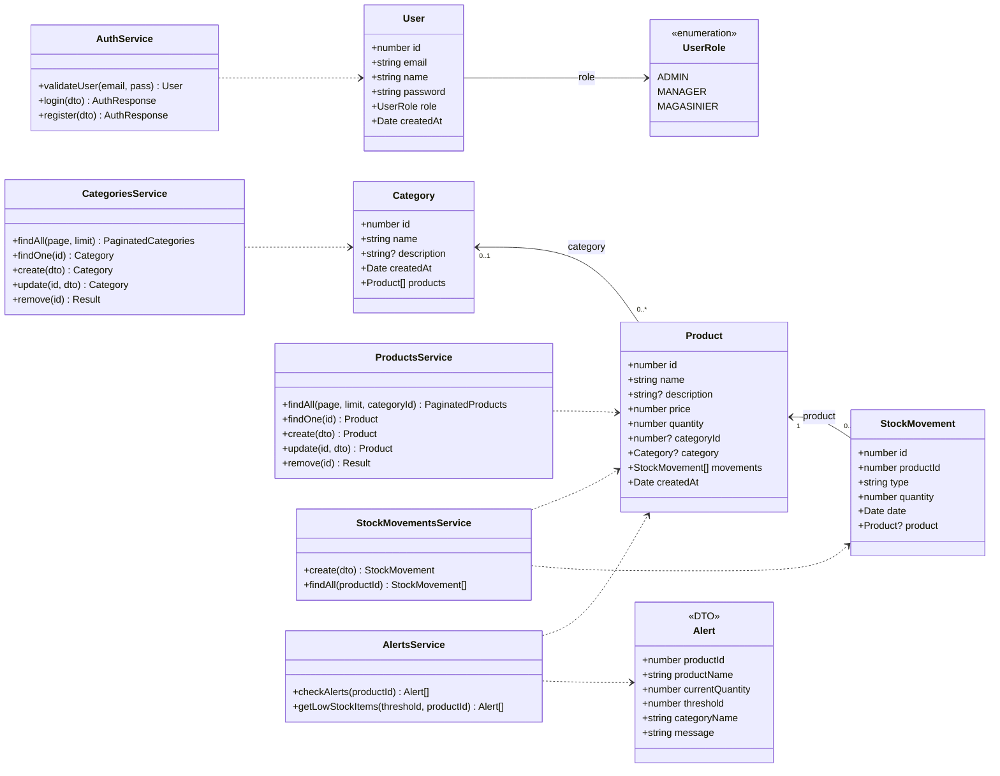

# Diagramme de classes

Ce diagramme represente les entites principales, les services NestJS et les dependances metier du projet StockManager.

## Lecture rapide

- `Product` est l'entite centrale du stock.
- `Category` regroupe des produits, mais un produit peut exister sans categorie.
- `StockMovement` conserve l'historique des entrees et sorties d'un produit.
- `Alert` n'est pas une table : c'est un objet calcule par `AlertsService`.
- `UserRole` pilote les permissions applicatives et API.
