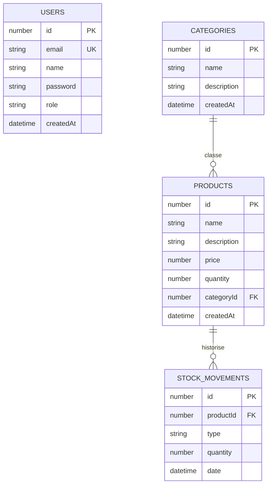

# Diagramme entite-association

Ce diagramme montre la structure relationnelle TypeORM/SQLite et les cardinalites de la base de donnees.

## Cardinalites

| Relation | Cardinalite | Regle |
| --- | --- | --- |
| `Category` -> `Product` | `1` categorie peut avoir `0..n` produits | Une categorie peut etre vide. |
| `Product` -> `Category` | `0..1` categorie par produit | `categoryId` est nullable ; suppression de categorie = `SET NULL`. |
| `Product` -> `StockMovement` | `1` produit peut avoir `0..n` mouvements | Un produit peut etre cree sans mouvement initial. |
| `StockMovement` -> `Product` | `1` produit obligatoire par mouvement | Suppression du produit = suppression des mouvements (`CASCADE`). |
| `User` -> autres tables | Aucune relation physique | Les droits sont portes par `role`, pas par une cle etrangere. |
