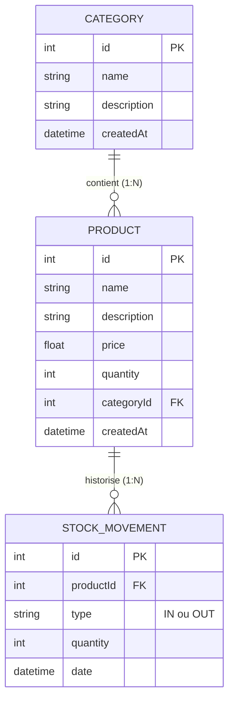

# Audit et Plan d'Implémentation - Stock Manager

## 1. État des Lieux : Ce qui est fait vs Ce qui reste à faire

| Composant | Ce qui est fait | Ce qui manquait / À implémenter |
| :--- | :--- | :--- |
| **Base de Données** | Dépendances TypeORM et SQLite présentes dans `package.json`. | Aucun branchement TypeORM : entités définies comme simples interfaces TypeScript, données stockées dans des tableaux temporaires perdus au redémarrage, pas de clés étrangères actives. |
| **Backend - Produits** | `findAll` mocké basique. | Pas de routes `@Post`, `@Put`, `@Delete`, `@Get(':id')` dans le contrôleur. Pas de pagination réelle SQL ni de filtre par catégorie. |
| **Backend - Catégories** | `findAll` mocké basique. | Pas de routes `@Post`, `@Put`, `@Delete` exposées dans le contrôleur. Pas de relation relationnelle vers les produits. |
| **Backend - Mouvements** | Méthodes de service in-memory partielles. | Contrôleur limité à `findAll`. Pas de route `@Post` pour enregistrer un mouvement, pas de transaction atomique pour incrémenter/décrémenter le stock d'un produit. |
| **Backend - Alertes** | Logique statique codée en dur avec des produits factices. | Non relié à la base de données réelle. Le seuil dynamique n'est pas pris en compte depuis les vrais produits. |
| **Frontend - Design & Emojis** | Couleurs standards Vite/Tailwind-like et emojis (`⏪`, `⏩`, `➕`, etc.). | **À nettoyer** : suppression de tous les stickers/emojis et mise en place stricte de la charte : `#2B2D42`, `#F8F9FA`, `#F77F00`. |
| **Frontend - Interactivité** | Listes basiques, boutons "Ajouter" et "Modifier" affichant `alert()`. | Formulaires réels (modals/drawers) pour ajouter/éditer produits et catégories, sélection dynamique des catégories, saisie libre des mouvements de stock. |

---

## 2. Modèle de Données Cible (TypeORM + SQLite)

---

## 3. Charte Graphique & Tokens Visuels

* **Couleur Principale (Dark Slate)** : `#2B2D42`
  * Utilisé pour la barre de navigation, les en-têtes de tableaux, les textes principaux, les boutons primaires.
* **Fond & Surfaces Neutres (Off-White)** : `#F8F9FA`
  * Utilisé pour le fond général, les cartes, les champs de formulaires, les lignes alternées de tableaux.
* **Accent & Actions (Vibrant Amber / Orange)** : `#F77F00`
  * Utilisé pour les boutons d'action clés (ajouter, valider), les alertes de stock critique, les badges de statut et les liens actifs.
* **Stickers & Emojis** : Bannis au profit d'icônes typographiques textuelles ou symboles épurés et clairs.
