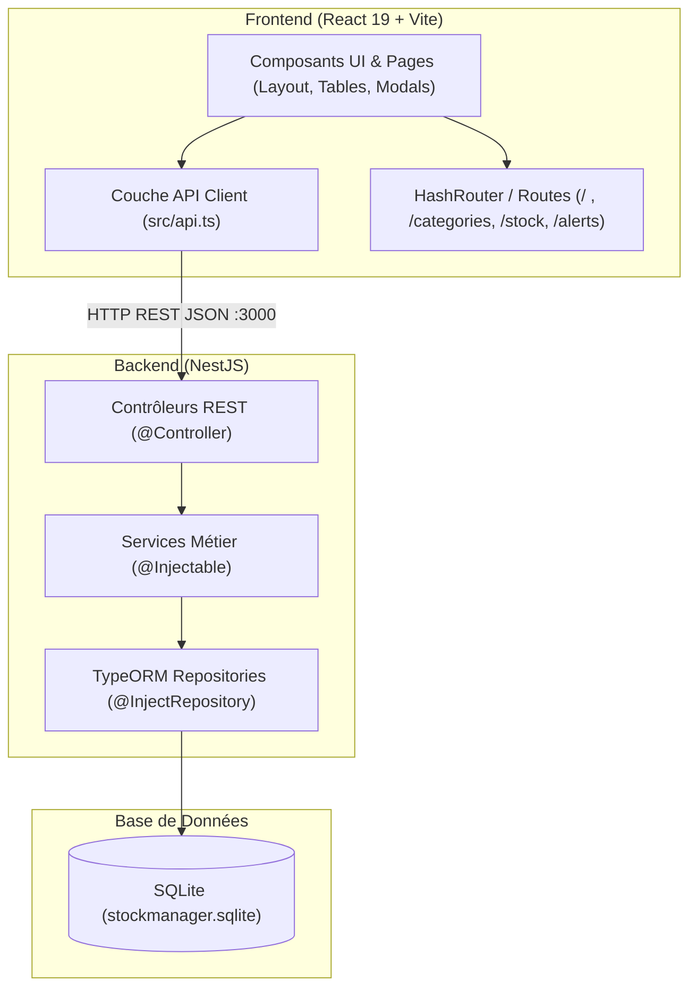

# Guide Technique et Maîtrise Complète du Projet Stock Manager

Ce document vous explique l'architecture complète, les choix de conception et le flux de données pour que vous maîtrisiez votre projet de bout en bout.

---

## 1. Vue d'Ensemble de l'Architecture

Le projet est conçu selon une architecture découplée **Fullstack TypeScript** :



---

## 2. Base de Données Relationnelle (TypeORM + SQLite)

### Pourquoi SQLite avec `better-sqlite3` ?
- **Autonome et persistant** : Aucun serveur externe (Docker, Postgres, MySQL) à démarrer. Le fichier `stockmanager.sqlite` est créé directement à la racine du backend et conserve toutes vos données entre chaque redémarrage.
- **Vraie base SQL relationnelle** : Gère les clés étrangères, les types de colonnes, les contraintes et les jointures SQL standard via l'ORM TypeORM.

### Les 3 Entités et leurs Relations
1. **`Category` (`categories`)** :
   * Attributs : `id`, `name`, `description`, `createdAt`.
   * Relation : `@OneToMany(() => Product, (p) => p.category)`. Une catégorie peut regrouper plusieurs produits.
2. **`Product` (`products`)** :
   * Attributs : `id`, `name`, `description`, `price`, `quantity`, `categoryId`, `createdAt`.
   * Relations :
     * `@ManyToOne(() => Category)` relié à `categoryId`. Si la catégorie est supprimée, `onDelete: 'SET NULL'`.
     * `@OneToMany(() => StockMovement)` : liste de tous les mouvements historiques du produit.
3. **`StockMovement` (`stock_movements`)** :
   * Attributs : `id`, `productId`, `type` (`IN` ou `OUT`), `quantity`, `date`.
   * Relation : `@ManyToOne(() => Product)` relié à `productId`. Si le produit est supprimé, `onDelete: 'CASCADE'`.

### Auto-Seeding (Initialisation automatique)
Dans `AppService`, la méthode `onApplicationBootstrap()` vérifie si la base de données est vide au démarrage. Si oui, elle insère automatiquement des catégories (Informatique, Bureautique, Mobilier), des produits avec des niveaux de stock variés et des mouvements de test.

---

## 3. Logique Métier Clé

### A. Mouvements de stock & Intégrité des données
Quand vous soumettez une entrée (`IN`) ou une sortie (`OUT`) dans `StockMovementsService` :
1. Le service charge le produit ciblé depuis la base.
2. Pour une sortie (`OUT`), il contrôle que `product.quantity >= quantity demandée`. Si le stock est insuffisant, il renvoie une erreur HTTP 400 claire.
3. Il ajuste la quantité du produit (`+=` ou `-=`) et sauvegarde le produit mis à jour.
4. Il enregistre l'historique du mouvement avec horodatage (`date`).
5. Les deux opérations garantissent que le stock affiché dans le catalogue est toujours parfaitement synchronisé.

### B. Module d'Alertes Dynamique
Le service d'alerte (`AlertsService`) exécute une requête SQL TypeORM :
```ts
where: { quantity: LessThanOrEqual(threshold) }
```
Dès que vous modifiez le seuil (ex: 2, 5 ou 10) dans l'interface, la requête est exécutée sur la base de données réelle et remonte tous les produits critiques.

---

## 4. Charte Graphique & Suppression des Stickers

Tous les stickers et emojis (`⏪`, `⏩`, `➕`, etc.) ont été retirés au profit d'un design professionnel épuré respectant les 3 couleurs imposées :

| Rôle | Code Couleur | Utilisation |
| :--- | :--- | :--- |
| **Primaire / Sévère** | `#2B2D42` | Barre de navigation, en-têtes de tableaux, titres, boutons primaires. |
| **Fond / Neutre** | `#F8F9FA` | Fond de l'application, champs de saisie, fonds alternés. |
| **Accent / Dynamique** | `#F77F00` | Boutons d'action clé (Nouveau produit, valider, réapprovisionner), badge d'alerte, lien actif. |

---

## 5. Comment Tester Personnellement Votre Projet

### 1. Démarrer le Backend (NestJS)
Ouvrez un terminal dans le dossier du backend :
```bash
cd /home/jams/Documents/myProjects/react-nest.js/stockManager/stockmanager
npm run start:dev
```
> Le backend écoute sur `http://localhost:3000`. Vous verrez les logs d'initialisation SQLite et d'auto-seeding.

### 2. Démarrer le Frontend (React + Vite)
Dans un second terminal :
```bash
cd /home/jams/Documents/myProjects/react-nest.js/stockManager/stockManager/client
npm run dev
```
> Le frontend sera disponible sur `http://localhost:3001`.

### 3. Parcours de Test Recommandé
1. **Catalogue Produits (`/`)** :
   - Observez les données de départ avec leurs statuts (En stock, Stock faible).
   - Testez le filtrage par catégorie.
   - Cliquez sur **Nouveau Produit** : remplissez le formulaire modal et enregistrez.
   - Testez la **Modification** et la **Suppression**.
2. **Gestion des Catégories (`/categories`)** :
   - Ajoutez une nouvelle catégorie (ex: "Accessoires").
   - Retournez sur les produits : votre nouvelle catégorie est immédiatement sélectionnable !
3. **Mouvements de Stock (`/stock`)** :
   - Cliquez sur **Enregistrer une Entrée (IN)** ou **Sortie (OUT)**.
   - Sélectionnez un produit et appliquez une quantité.
   - Vérifiez que le stock du produit sur la page Catalogue a instantanément changé !
4. **Alertes de Stock (`/alerts`)** :
   - Changez le seuil critique (2, 5, 10).
   - Constatez que la liste se met à jour en temps réel avec un bouton direct **Réapprovisionner**.
